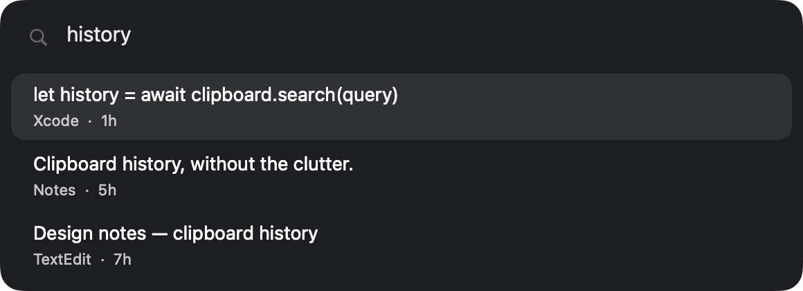
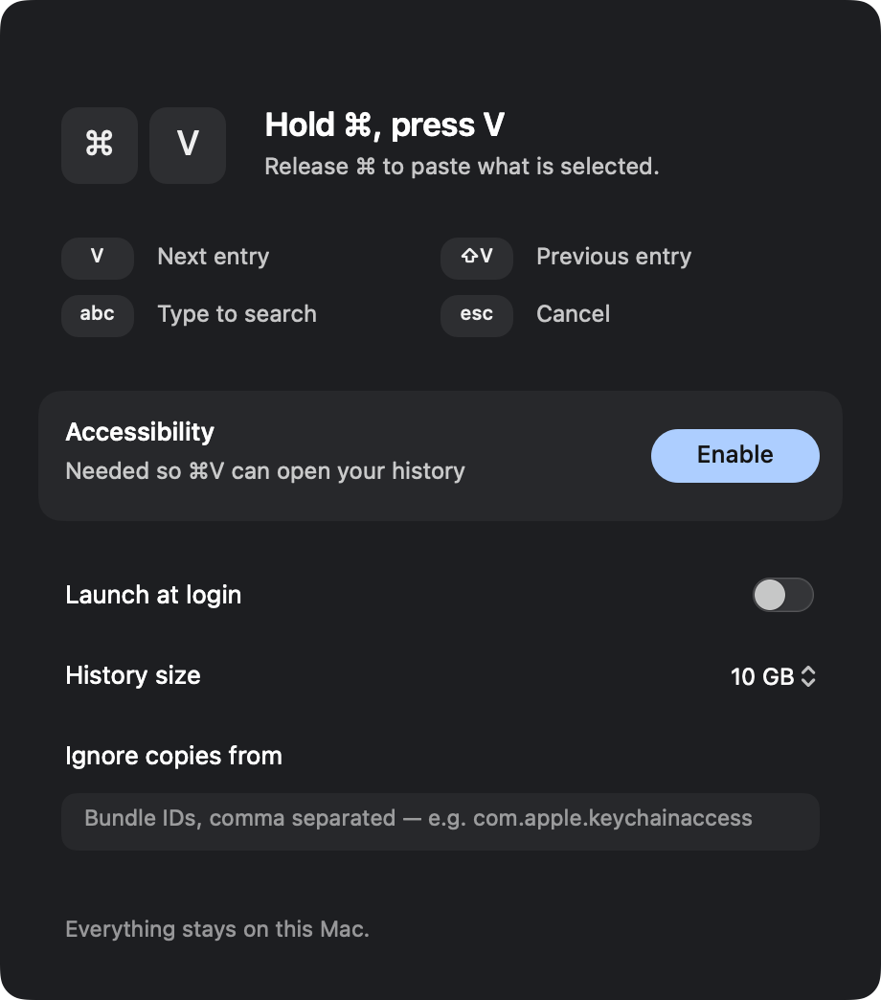

<p align="center">
  
</p>

<p align="center">
  <a href="https://github.com/desenyon/SuperCopy/actions/workflows/ci.yml"></a>
  
  
  <a href="LICENSE"></a>
</p>

<p align="center">
  A native clipboard manager that keeps useful things close.<br>
  Text, images, code, audio, and files. Remembered locally. One shortcut away.
</p>

<p align="center">
  <a href="#screenshots">Screenshots</a> &nbsp;·&nbsp;
  <a href="#make-it-yours">Customization</a> &nbsp;·&nbsp;
  <a href="#install">Install</a> &nbsp;·&nbsp;
  <a href="#the-gesture">Shortcuts</a> &nbsp;·&nbsp;
  <a href="docs/PRIVACY.md">Privacy</a> &nbsp;·&nbsp;
  <a href="#build-and-verify">Build</a>
</p>

## Less searching. More doing.

- **Remember the original.** Rich text, images, audio data, copied files, and custom clipboard formats retain their published representations.
- **Search the thought.** Exact and prefix matching, on-device English sentence similarity, and local OCR for text inside images.
- **Stay in your flow.** A compact floating picker, keyboard navigation, small image previews, and natural scrolling without a scrollbar.
- **Own your history.** Local storage, app exclusions, optional login launch, and a storage budget you control. No account, server, or telemetry.

## Screenshots

### Everything you copied, in one place

<p align="center">
  <a href="docs/assets/clipboard.png"></a>
</p>

Hold <kbd>⌘</kbd> and press <kbd>V</kbd>. The latest copy is selected. Tap <kbd>V</kbd> again to move down; release <kbd>⌘</kbd> to paste.

### A few letters back to what you need

<p align="center">
  <a href="docs/assets/search.png"></a>
</p>

Typing keeps search open. Press <kbd>Return</kbd> to paste a result, or <kbd>Escape</kbd> to leave it alone. Audio is searchable by name and metadata; image search uses OCR. Audio transcription and visual object recognition are not included.

<sub>These are real AppKit views rendered offscreen with sample data and the opaque accessibility fallback. No private clipboard content or desktop capture is used. Live backdrop blur is not shown.</sub>

## Make it yours

Open the menu-bar icon → **Settings…** to choose what SuperCopy keeps and when it runs.

<p align="center">
  <a href="docs/assets/settings.png"></a>
</p>

| Your preference | Where to set it |
| --- | --- |
| Start when you sign in | Enable **Launch at login** |
| Keep a smaller or larger archive | Choose **1, 5, 10, or 50 GB**, or **Unlimited**; default **10 GB** |
| Leave private apps out | Enter comma-separated bundle IDs in **Ignore copies from** |
| Take a break from capture | Choose **Pause history** in the menu bar |
| Reduce motion or transparency | Use macOS **Accessibility → Display**; SuperCopy follows both settings |

The app labels storage in GB and uses binary GiB budgets. Settings also shows the app version and build number. The dark palette and ⌘V shortcut are fixed in this version. [Read the customization guide](docs/CUSTOMIZATION.md) for exclusion examples, storage behavior, and build options.

## Install

Requires **macOS 14 or later**. Universal DMGs contain Apple Silicon and Intel binaries.

1. Open the SuperCopy DMG and drag **SuperCopy** to **Applications**.
2. Eject the image, then open SuperCopy from Applications.
3. Open **Settings → Enable** and allow SuperCopy under **System Settings → Privacy & Security → Accessibility**.

SuperCopy lives in the menu bar, with no Dock icon. Launch at login stays optional. Permission changes are detected automatically.

Download the development DMG and SHA-256 checksum from [GitHub Releases](https://github.com/desenyon/SuperCopy/releases). These initial downloads are development builds and are not notarized. Standard Gatekeeper distribution still needs Developer ID signing, notarization, and clean-machine checks. [Get a signing certificate](docs/RELEASING.md#get-a-developer-id-signing-identity).

Successful [CI runs](https://github.com/desenyon/SuperCopy/actions/workflows/ci.yml) also attach development DMGs; workflow artifact downloads require GitHub sign-in.

To build and install locally with a Swift 6 toolchain:

```sh
git clone https://github.com/desenyon/SuperCopy.git
cd SuperCopy
./scripts/build.sh --install
```

## The gesture

| Shortcut | Result |
| --- | --- |
| <kbd>⌘</kbd> + <kbd>V</kbd> | Open history with the current clipboard selected |
| Keep <kbd>⌘</kbd> held, tap <kbd>V</kbd> | Move down one entry per physical press |
| Keep <kbd>⌘</kbd> held, press <kbd>⇧V</kbd> | Move back up |
| Release <kbd>⌘</kbd> | Paste once; a quick ⌘V uses the latest copy |
| Type, or click search | Search and keep the picker open |
| <kbd>↑</kbd> / <kbd>↓</kbd> | Move through results |
| <kbd>Return</kbd>, or click a result | Paste the selection |
| <kbd>Escape</kbd>, or click outside | Cancel |
| <kbd>⌘C</kbd> in the picker | Copy the selection without pasting |
| <kbd>⌘Delete</kbd> in the picker | Remove the selection from history |

Holding V does not race through entries. Modified paste shortcuts such as ⌘⇧V retain their normal behavior outside the gesture. Pasting an older entry returns it to the top.

A pending paste cancels if the app, clipboard, or secure-input state changes. Secure keyboard input, read-only fields, and app-specific restrictions can prevent interception or insertion. [Compatibility and manual checks](docs/COMPATIBILITY.md).

## Local means local

History lives in `~/Library/Application Support/SuperCopy/`. Original copied files are archived so they can survive source deletion. Content is deduplicated, older history loads in pages, and storage has no entry-count limit.

Sensitive clipboard markers are skipped, but **unmarked passwords can still be saved**. Exclude private apps or pause history. There is no extra encryption layer; use FileVault for disk protection. [Privacy policy](docs/PRIVACY.md).

Semantic search depends on Apple's installed English model and falls back to literal/prefix matching. Polling cannot recover clipboard values replaced between checks. [Capture and resource limits](docs/STORAGE.md).

## Build and verify

Swift · AppKit · SQLite · NaturalLanguage · Vision. No third-party app packages or web runtime.

<details>
<summary><strong>Development commands</strong></summary>

Install Apple's Command Line Tools with `xcode-select --install` if needed.

```sh
export EDITOR=vim VISUAL=vim GIT_EDITOR=vim
./scripts/test.sh
./scripts/build.sh --ad-hoc
```

Tests use private pasteboards and temporary history. The integration test runs real gesture, panel, store, and clipboard code, then records paste events instead of sending them to other apps. [Verification results and remaining live checks](docs/VERIFICATION.md).

</details>

<details>
<summary><strong>Build a universal DMG</strong></summary>

```sh
brew install uv  # packaging tooling only
./scripts/package-dmg.sh --universal
```

The DMG and its SHA-256 file appear in `dist/`. It includes a custom black installer background and a drag-to-Applications layout. For signed and notarized public images, follow [Releasing](docs/RELEASING.md#public-downloads).

</details>

<details>
<summary><strong>Reproduce the screenshots</strong></summary>

```sh
./scripts/build.sh
dist/SuperCopy.app/Contents/MacOS/SuperCopy --render-fixtures /tmp/SuperCopy-screenshots
```

This writes clipboard, search, and Settings PNGs using sample content. Rendering the built bundle includes its actual version in Settings. It does not show windows, read your clipboard, or take focus. Offscreen mode disables animations and uses an opaque background.

</details>

---

<p align="center">
  <a href="docs/ARCHITECTURE.md">Architecture</a> &nbsp;·&nbsp;
  <a href="CONTRIBUTING.md">Contribute</a> &nbsp;·&nbsp;
  <a href="https://github.com/desenyon/SuperCopy/issues/new/choose">Report a bug</a> &nbsp;·&nbsp;
  <a href="SECURITY.md">Security</a> &nbsp;·&nbsp;
  <a href="LICENSE">MIT license</a>
</p>
<p align="center"><sub>Made for your Mac. Built to stay out of your way.</sub></p>
