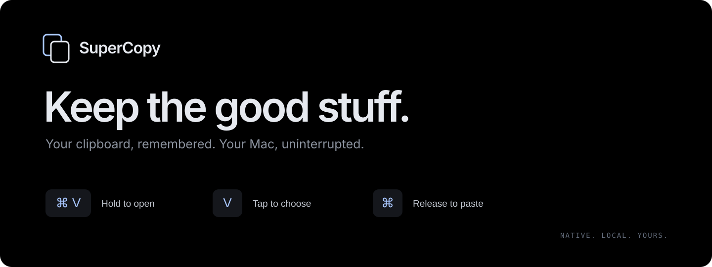
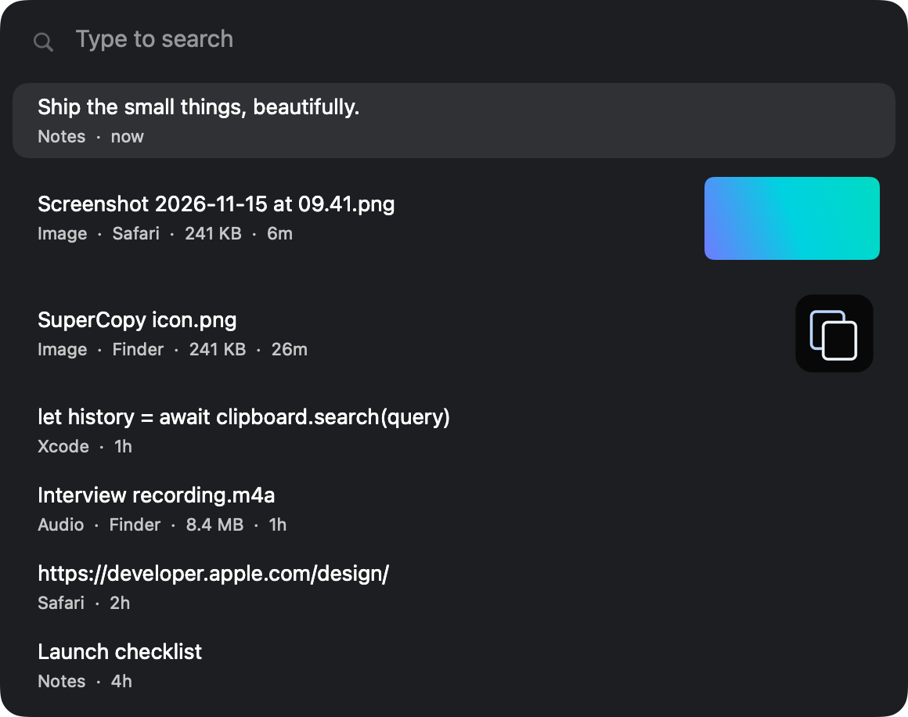

<p align="center">
  
</p>

<p align="center">
  <a href="https://github.com/desenyon/SuperCopy/actions/workflows/ci.yml"></a>
  
  
  <a href="LICENSE"></a>
</p>

<p align="center">
  A small, native clipboard manager with a better way to paste.<br>
  Hold <kbd>⌘</kbd>, tap <kbd>V</kbd> to choose, release to paste. Everything stays on your Mac.
</p>

<p align="center">
  <a href="#get-started">Get started</a> ·
  <a href="#the-gesture">The gesture</a> ·
  <a href="docs/PRIVACY.md">Privacy</a> ·
  <a href="docs/VERIFICATION.md">Verification</a> ·
  <a href="docs/RELEASING.md">Release status</a>
</p>

---

<p align="center">
  
  <br><sub>Actual AppKit views with sample content, rendered offscreen using the opaque accessibility fallback.</sub>
</p>

### A little less friction

- **Keep more than text.** Preserve images, audio data, copied files, rich text, and custom clipboard formats.
- **Find the thought.** Exact and prefix search, on-device English sentence similarity, and local image OCR.
- **Stay where you are.** A floating picker, keyboard navigation, compact image previews, and natural scrolling without a scrollbar.
- **Keep it local.** No account, server, telemetry, or third-party packages. Capture exclusions and storage limits are yours to set.
- **Let macOS do the work.** Swift, AppKit, SQLite, NaturalLanguage, and Vision. No web runtime.

### Get started

SuperCopy is distributed directly as a **DMG**. Open the image, drag SuperCopy to Applications, eject the image, then open SuperCopy from Applications. Development images are not notarized; the public-release requirements are in [Releasing](docs/RELEASING.md).

Building from source requires macOS 14 or later and a Swift 6 toolchain. Install Apple's Command Line Tools with `xcode-select --install` if needed.

```sh
git clone https://github.com/desenyon/SuperCopy.git
cd SuperCopy
./scripts/build.sh --install
```

Open **SuperCopy → Settings → Enable**, then allow SuperCopy under **System Settings → Privacy & Security → Accessibility**. The app detects changes automatically. The build installs and launches in the background; there is no Dock icon. Launch at login is optional.

To build a universal Apple Silicon + Intel drag-to-Applications installer:

```sh
brew install uv  # packaging tools only; not an app dependency
./scripts/package-dmg.sh --universal
```

The DMG and its SHA-256 checksum are written to `dist/`. The installer has a minimal black background and a direct Applications shortcut. [Signed and notarized packaging](docs/RELEASING.md#public-downloads).

Local builds use a stable, self-signed development identity. They are for personal use, and are not Apple-notarized downloads. CI artifacts contain ad-hoc-signed development DMGs. For public distribution, follow [Releasing](docs/RELEASING.md).

### The gesture

| You do | SuperCopy does |
| --- | --- |
| Press **⌘V** | Opens history with your current clipboard selected |
| Release **⌘** | Pastes the selection once; a quick ⌘V uses the latest copy |
| Tap **V** again while holding **⌘** | Moves down one entry per physical press |
| Press **⇧V** | Moves back up |
| Press **↑ / ↓** | Moves through history |
| Type, or click the search field | Searches and keeps the picker open |
| Press **Return**, or click a result | Pastes the selected result |
| Press **Escape**, or click outside | Cancels |
| Press **⌘C** in the picker | Copies the selection without pasting |
| Press **⌘Delete** in the picker | Removes the selection from history |

Holding V does not race through entries. **⌘⇧V** and other modified paste shortcuts retain their normal behavior outside the active gesture. An older entry returns to the top when pasted.

Paste uses the normal session event stream and waits for the original app and released modifiers. Switching apps, changing the clipboard, or enabling secure input cancels a pending automatic paste. Secure input, read-only controls, app-specific paste restrictions, and some remote/custom controls can prevent interception or insertion. See [compatibility checks](docs/COMPATIBILITY.md); universal text-field compatibility is not claimed.

### Your history, under your control

History lives in `~/Library/Application Support/SuperCopy/`. There is no entry-count limit; the default storage budget is **10 GiB**, with 1, 5, 50 GiB and Unlimited options. Content is deduplicated, copied files are archived, and the interface loads history in bounded pages.

Sensitive clipboard markers are skipped, but **unmarked passwords can still be saved**. Exclude private apps or pause history. There is no extra encryption layer; use FileVault for disk protection. [Read the privacy policy](docs/PRIVACY.md).

Audio is searchable by name and metadata, not transcribed. Image search uses OCR, not visual object recognition. English semantic search depends on Apple's installed model and falls back to literal/prefix matching. Polling cannot recover clipboard values replaced between checks. [Storage and capture limits](docs/STORAGE.md).

### Built to be inspected

```sh
export EDITOR=vim VISUAL=vim GIT_EDITOR=vim
./scripts/test.sh
./scripts/build.sh --ad-hoc
```

Tests use private pasteboards and temporary storage. The offscreen integration test runs the real gesture, panel, history, and clipboard code, then records synthetic paste events instead of sending them to other apps. It also checks focus/modifier races and cancellation. [See what was verified—and what remains manual](docs/VERIFICATION.md).

For layout fixtures without showing windows or taking focus:

```sh
dist/SuperCopy.app/Contents/MacOS/SuperCopy --render-fixtures /tmp/SuperCopy-layouts
```

[Architecture](docs/ARCHITECTURE.md) · [Contributing](CONTRIBUTING.md) · [Report a bug](https://github.com/desenyon/SuperCopy/issues/new/choose) · [Security](SECURITY.md)

### Distribution status

SuperCopy uses **direct DMG distribution**, preserving the complete ⌘V interaction. Local and CI development images are explicitly named `-development.dmg`. Public downloads need Developer ID signing, notarization, and clean-machine compatibility checks. The [release guide](docs/RELEASING.md) covers those steps; no App Store edition is planned in this distribution workflow.

---

<p align="center"><sub>Made for the Mac. MIT licensed.</sub></p>
